<p align="center">
  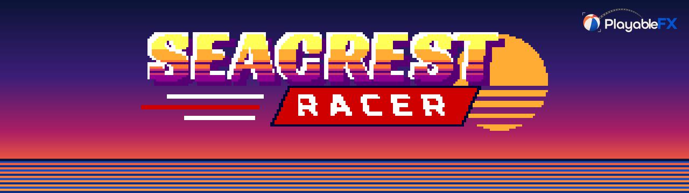
</p>

<p align="center">
  <b>A 16-bit polygon arcade racer for the Sega Genesis / Mega Drive, with a no-code SDK for building your own tracks and cars.</b>
</p>

<p align="center">
  
  
  
  
</p>

<p align="center">
  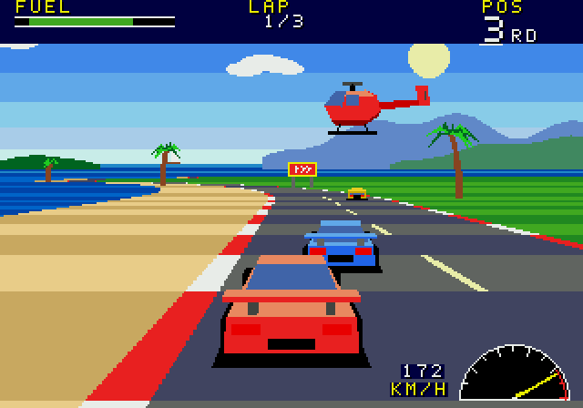
</p>

Seacrest Racer is a love letter to mid-90s arcade racers, running on a stock 16-bit console with no add-on chips. You get a fake-3D road, a real polygon player car the console draws itself, three rivals, a camera helicopter, a flag-waving starter, tyre smoke and an original techno soundtrack. It also ships with a **no-code software development kit**, a track and car editor in a single web page that writes new cartridges directly, so nobody has to touch a compiler.

| | |
|:---:|:---:|
| 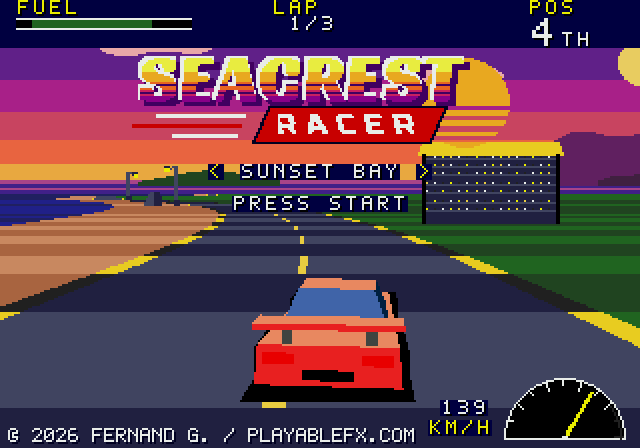 | 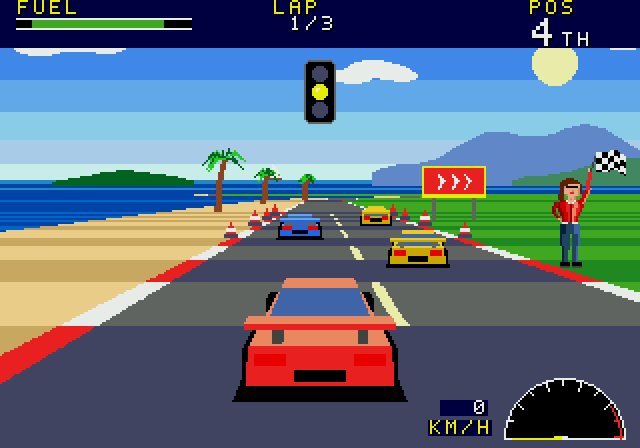 |
| **Title screen.** Pick a course with left / right. | **The start.** Red, amber, green, go. |
| 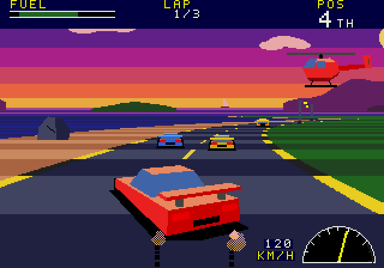 | 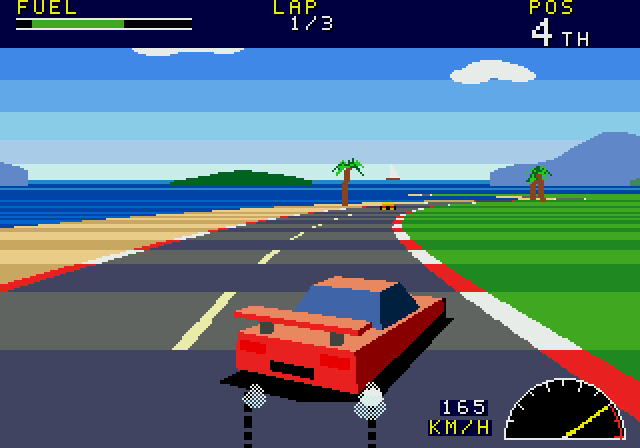 |
| **Sunset Bay.** Drift under the camera helicopter. | **Seacrest Coast.** Brake + steer leaves skid marks and smoke. |
| 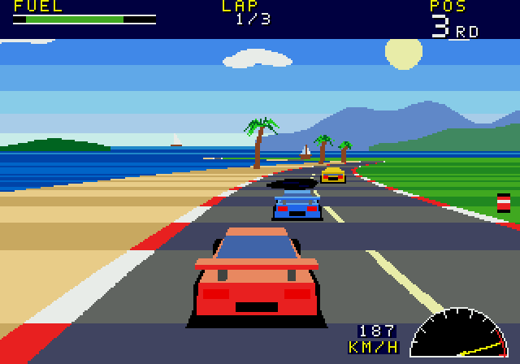 | 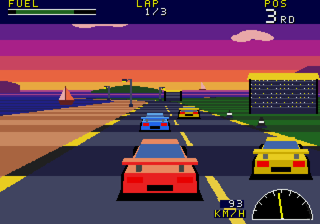 |
| **Hazards** from the SDK: oil slicks and loose tyres. | **Sunset Bay's** grandstand straight at dusk. |

---

## Contents

- [Download and play](#download-and-play)
- [How to play](#how-to-play)
- [The no-code SDK](#the-no-code-sdk)
- [Building from source](#building-from-source)
- [How it works](#how-it-works)
- [Repository layout](#repository-layout)
- [License and credits](#license-and-credits)

---

## Download and play

| File | What it is |
|---|---|
| [`dist/seacrest_racer.md`](dist/seacrest_racer.md) | The game: a 256 KB cartridge ROM |
| [`dist/seacrest_devkit.html`](dist/seacrest_devkit.html) | The no-code SDK (track and car editor) |
| [`seacrest_game-manual.pdf`](seacrest_game-manual.pdf) | The 12-page instruction manual |

**In an emulator:** load `seacrest_racer.md` in any accurate emulator. It's tested in **Genesis Plus GX**, which is also the RetroArch / RetroPie core `lr-genesis-plus-gx`. BlastEm and Kega Fusion should work too.

**On a real console:** copy `seacrest_racer.md` to a flash cartridge such as a Mega EverDrive. The game is built for real hardware, but it **hasn't been tested on a real console yet**, so reports are very welcome.

## How to play

<table>
<tr>
<td valign="top">

| Button | Action |
|---|---|
| **D-pad ◀ ▶** | Steer |
| **A** or **C** | Accelerate (automatic 5-speed) |
| **B** | Brake |
| **B + ◀/▶** at speed | Drift: swing the tail out and turn tighter |
| **START** | Start a race / skip the results |
| **◀ ▶** on the title | Choose the course |

</td>
<td valign="top" width="420">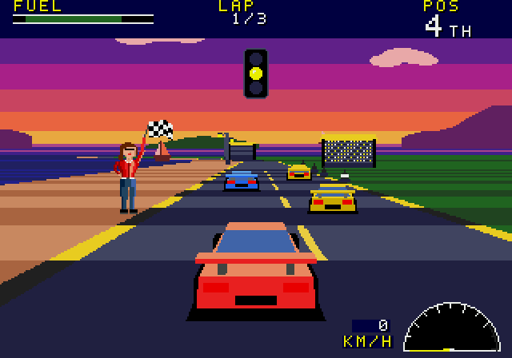</td>
</tr>
</table>

- **Three laps, three rivals.** You start fourth. Wait for green.
- **Fuel is your clock.** The gauge at the top left drains as you drive. Passing the halfway **checkpoint** and finishing each **lap** tops it up. Run dry and it's OUT OF FUEL.
- **Stay off the walls.** The road edge scrapes off speed every time you touch it.
- **Hazards.** On custom tracks, an **oil slick** sends you into a fishtail for about a second, and a **loose tyre** knocks off about an eighth of your speed.

The [manual](seacrest_game-manual.pdf) has the full rules, driving techniques and course maps.

---

## The no-code SDK

<p align="center">
  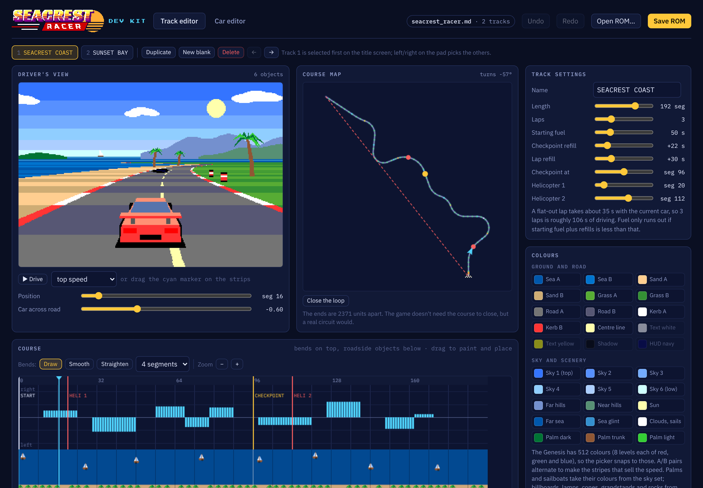
</p>

The Seacrest Racer Dev Kit is a **no-code software development kit**. It's one self-contained web page that opens the game's ROM, lets you change tracks and the car visually, and saves a brand-new cartridge. There's **no compiler, toolchain or install**. Edited ROMs run in emulators and on real hardware exactly like the original.

**How it works:** the game reads its tracks and car from a 64 KB data block at ROM address `0x30000`. The editor rewrites that block and fixes the ROM checksum, and the game code itself never changes. The format is documented in [`docs/data_format.md`](docs/data_format.md).

### Open it

1. Download [`dist/seacrest_devkit.html`](dist/seacrest_devkit.html) and open it in Chrome, Firefox or Edge. It works offline.
2. It starts with the built-in cartridge loaded. To edit another one, click **Open ROM…** and pick a `.md` file.
3. Click **Save ROM** when you're done. The new cartridge goes to your downloads folder.

### Build a track in five steps

1. Click a track tab, or **Duplicate** / **New blank**. A cartridge holds up to four tracks.
2. **Draw the bends** on the course strip: drag up for right-handers and down for left-handers. **Smooth** and **Straighten** tidy them up, and **Close the loop** bends the course gently until its end meets its start.
3. **Place objects.** Choose a type (palm, sailboat, billboard, lamp, cone, grandstand, rock, shrub, beach umbrella, tyre wall, oil drum, oil slick, loose tyre, flag girl), then click the lower strip. Drag objects to move them, press <kbd>Del</kbd> to remove one, or use **Add a row** to line a whole straight.
4. **Tune it:** length, laps, starting fuel and refills, checkpoint position, helicopter flyovers, and every ground and sky colour (snapped to the console's 512 colours).
5. Press **▶ Drive** to preview the driver's view, which uses the game's own road maths. Check the **Checks** panel, then **Save ROM**.

<p align="center">
  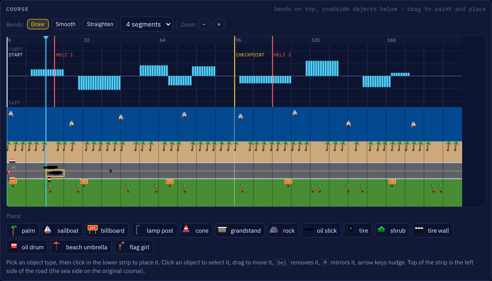
</p>

### Edit the car

<p align="center">
  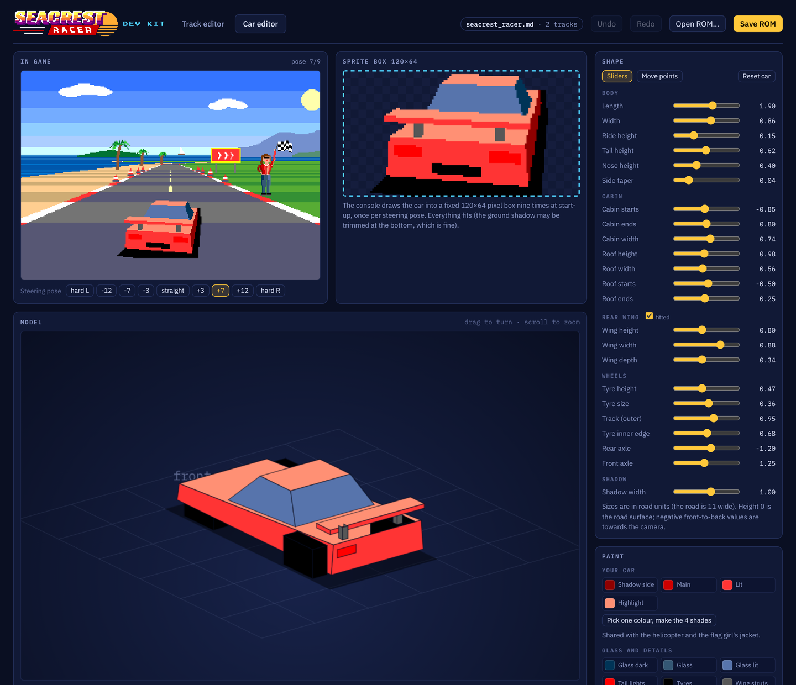
</p>

- **Shape:** use sliders for length, width, cabin, roof, wing and wheels, or switch to **Move points** and drag individual points of the 3D model (with left / right mirroring).
- **Paint:** your car, its glass and tail lights, and both rival colours.
- **Handling:** top speed in km/h, acceleration (shown as a 0–160 km/h time), steering, drift boost, brakes and grip.
- **Sprite box preview:** shows exactly what the console will draw at each of the nine steering poses, and warns you if anything would be cut off.

### Limits the SDK checks for you

| Limit | Why |
|---|---|
| 4 tracks, 128 objects per track, about 25 on screen at once | Sprite limits of the console |
| 276 tiles of art memory per track | Each *kind* of object loads its pictures into video memory. Palms plus grandstands leave little room. |
| Car: 128 points, 96 faces, 120×64 pixel sprite box | Memory and the boot-time rasteriser |
| Colours snap to 8 levels per channel | The console's 9-bit colour |

Some changes still need a rebuild from source: new kinds of object (new art), the rival car shape (rivals are pre-drawn sprites), more than four tracks, HUD colours and music.

---

## Building from source

You need:

- an `m68k-elf` cross toolchain (built and tested with **GCC 13.2 + binutils**)
- **Python 3** with **Pillow**

```sh
PATH=/path/to/m68k-elf/bin:$PATH ./build.sh   # writes out/seacrest_racer.md
python3 tools/build_editor.py                 # writes out/seacrest_devkit.html
```

`build.sh` regenerates all art (`tools/gen_assets.py`), music (`tools/gen_music.py`) and the default track and car data (`tools/gen_data.py`), then compiles, links and fixes the ROM header.

Useful places to start:

| To change | Look in |
|---|---|
| Default tracks and car handling | `tools/gen_data.py` (or just use the SDK) |
| Car shape defaults | `DEFAULT_CAR` in `tools/gen_assets.py` |
| Roadside object art | `draw_*` functions and `make_type(...)` in `tools/gen_assets.py` |
| Flag girl | `tools/girl_art.py` (hand-placed pixel art) |
| Title logo | `tools/make_logo.py` → `tools/art/logo.png` |
| Steering, hazards, rivals | `update_player`, `reset_race`, `update_rivals` in `src/main.c` |
| Engine sound | `update_sound` in `src/main.c` |
| Music | `tools/gen_music.py` |
| The manual | `docs/manual/manual.html`, printed with `node docs/manual/build_manual.js` |

## How it works

- **Road:** fake 3D. Every scanline below the horizon picks its own row of a pre-drawn road image (per-line vertical scroll from a scanline interrupt) and its own horizontal offset (curves and steering).
- **Player car:** real 3D. At boot the 68000 transforms, culls, lights and rasterises the car model from the ROM data block at nine steering angles. During play the matching pose is shown instantly, so the car reacts on the same frame you steer.
- **Rivals, roadside objects, helicopter, flag girl:** pre-rendered sprite frames, scaled by distance. Roadside art is loaded per track into a shared video memory pool.
- **Title screen:** the logo borrows the rival cars' tiles and palette while the title is up, and hands them back when the race starts.
- **Sound:** an original 150 BPM techno track on the FM chip, your engine on its own FM channel through five gears, the nearest rival's engine on a PSG channel with an exaggerated Doppler shift, and tyre squeal and wall scrape on another.
- **Game loop:** locked 30 fps with double-buffered scroll and sprite tables.

## Repository layout

```
dist/                     ready-to-use ROM and SDK page
seacrest_game-manual.pdf  the instruction manual
src/                      68000 C and assembly (main.c, crt0.s, linker script)
tools/                    asset, music, data and editor generators (Python)
tools/art/                logo and credit art
editor/                   SDK page source (devkit.src.html)
docs/data_format.md       the editable ROM data block, byte by byte
docs/manual/              manual source and PDF builder
docs/images/              README images
```

## License and credits

<a href="https://playablefx.com">
  <picture>
    <source media="(prefers-color-scheme: dark)" srcset="docs/images/playablefx.png">
    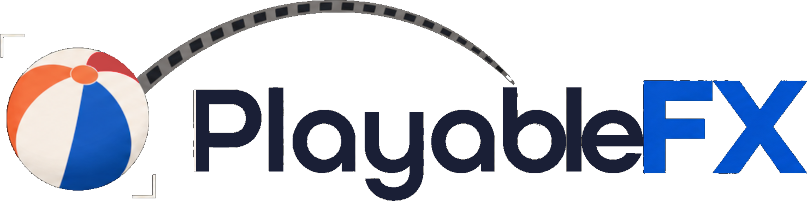
  </picture>
</a>

**© 2026 Fernand G. / [PlayableFX.com](https://playablefx.com)**

Licensed under the **[PolyForm Noncommercial License 1.0.0](LICENSE.md)**:

- ✅ Play, copy, share, modify and build on the game and the SDK for any **noncommercial** purpose.
- ✅ Share the tracks, cars and ROMs you make with the SDK.
- 📝 Anything you pass on, modified or not, must include the license and the `Required Notice` line from [`NOTICE`](NOTICE), so the original author stays credited.
- 🚫 Selling it, or using it in a commercial product or service, needs written permission from the author.

Noncommercial licenses are *source-available*, not *open source* in the OSI sense, because open source licenses must allow commercial use.

All game art, music, code and level data are original to this project. The title logo was lettered with Racing Sans One and Russo One, and the manual is set in IBM Plex; all are under the SIL Open Font License. Built with the help of Claude.

<sub>Seacrest Racer is an independent fan homage to 1990s arcade racers. It is not affiliated with, endorsed by or connected to Sega, Bandai Namco or any other publisher. Sega, Genesis and Mega Drive are trademarks of Sega Corporation.</sub>
